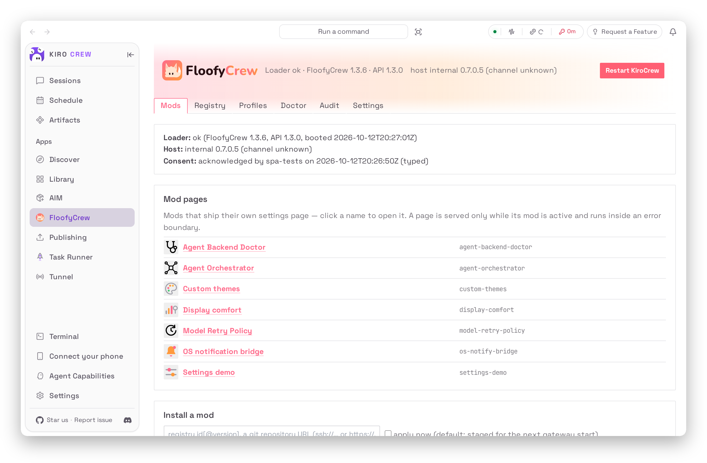
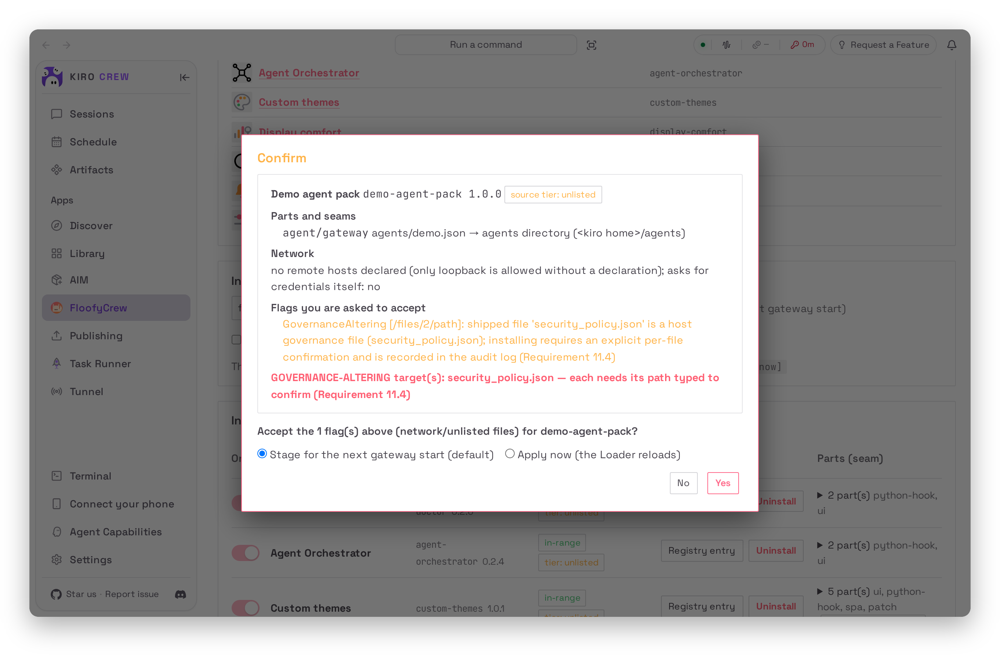
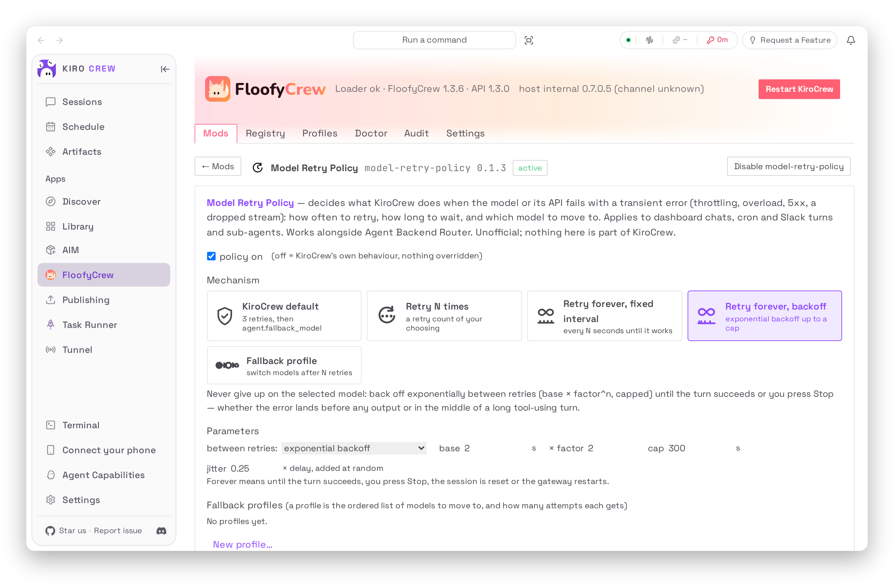

<a id="readme-top"></a>

<div align="center">
  <a href="https://github.com/floofycrew/FloofyCrew">
    
  </a>
  <h1><b>FloofyCrew</b></h1>
  <p>
    Mods for <a href="https://github.com/kirodotdev/KiroCrew">KiroCrew</a>: install a theme, a fix or a whole new page with one click &mdash; and keep it through every update.
  </p>
  <p>
    <a href="https://github.com/floofycrew/FloofyCrew/issues/new?labels=bug">Report a bug</a>
    &middot;
    <a href="https://github.com/floofycrew/FloofyCrew/issues/new?labels=enhancement">Request a feature</a>
    &middot;
    <a href="https://github.com/floofycrew/floofycrew-registry">Browse the mod registry</a>
  </p>
  <p>
    <a href="https://github.com/floofycrew/FloofyCrew/releases/latest"></a>
    <a href="https://github.com/floofycrew/FloofyCrew/blob/main/LICENSE"></a>
    <a href="https://github.com/floofycrew/FloofyCrew/stargazers"></a>
    <a href="https://github.com/floofycrew/FloofyCrew/issues"></a>
  </p>
  <br>
  
</div>

<br>

<details>
  <summary><b>Table of contents</b></summary>
  <ol>
    <li><a href="#what-is-it">What is it?</a></li>
    <li><a href="#why-use-it">Why use it?</a></li>
    <li><a href="#install">Install</a></li>
    <li><a href="#what-you-can-do">What you can do</a>
      <ul>
        <li><a href="#install-mods-on-your-own-terms">Install mods on your own terms</a></li>
        <li><a href="#every-mod-gets-a-page">Every mod gets a page</a></li>
        <li><a href="#survive-every-kirocrew-update">Survive every KiroCrew update</a></li>
        <li><a href="#make-your-own">Make your own</a></li>
      </ul>
    </li>
    <li><a href="#the-mods">The mods</a></li>
    <li><a href="#layout">Layout</a></li>
    <li><a href="#documentation">Documentation</a></li>
    <li><a href="#development">Development</a></li>
    <li><a href="#credits-and-license">Credits and license</a></li>
  </ol>
</details>

## What is it?

FloofyCrew is an unofficial mod manager and loader for [KiroCrew](https://github.com/kirodotdev/KiroCrew).
It adds a **FloofyCrew** page to your dashboard where you install mods from a
signed registry (or straight from a git link), switch them on and off, and
restart the gateway when you are done. Nothing in your KiroCrew install is ever
replaced, every change is logged and reversible, and `floofy restore --all`
takes it all back out.

## Why use it?

- **Easy** &mdash; `floofy install <mod>`, or click *Install* in the dashboard.
  Restart KiroCrew from the same page.
- **Safe** &mdash; every mod runs on your explicit consent; registry indexes are
  signature-verified; a mod that does not match your KiroCrew version is
  quarantined, not applied blind.
- **Yours** &mdash; scaffold a theme, a patch or a settings page with
  `floofy new`, test it against the real dashboard, publish it to the registry.

Works with both the internal and the public (open-source) edition of KiroCrew.

## Install

**Public edition** (GitHub releases, verified against `SHA256SUMS`):

```bash
curl -fsSL https://raw.githubusercontent.com/floofycrew/FloofyCrew/main/packaging/public/install.sh | sh
floofy doctor
```

or into the host's own virtualenv: `pip install floofycrew-<version>-py3-none-any.whl`.

Every install path ends in `floofy init`, which shows a one-time warning and
installs nothing until you agree. Then open **FloofyCrew** in the dashboard
sidebar, or run `floofy` for the interactive terminal. Updating FloofyCrew
itself: `floofy self-update`, or the *Update & restart* button when the App
tells you a new release is out.

> FloofyCrew is a community project. It is not affiliated with, endorsed by or
> supported by Kiro or the KiroCrew maintainers. It attaches to the KiroCrew you
> already have and never ships a rebuilt one; the risk of every mod you install
> is yours. Read [docs/consent-and-trust.md](docs/consent-and-trust.md) before
> `floofy init`.

Current release: **1.3.10** &mdash; what each release ships is in
[CHANGELOG.md](CHANGELOG.md); the KiroCrew versions it supports are in
`pyproject.toml` (`[tool.floofycrew] supports`) and in the release's
`supports.json`.

<div align="right">[<a href="#readme-top">back to top</a>]</div>

---

## What you can do

### Install mods on your own terms

Before anything lands, FloofyCrew tells you what the mod is made of &mdash; its
parts, the seams it uses, the hosts it talks to &mdash; and asks. A mod that
touches a host governance file needs its path typed back; a mod with an
undeclared network host is flagged, never silently allowed. Installs stage for
the next gateway start unless you say *Apply now*.

<div align="center">
  
</div>

### Every mod gets a page

Mods that ship their own settings page show up under *Mod pages*: click the
name and the page opens inside the manager, isolated in its own error boundary,
served only while the mod is active. Toggle the mod off and the page is gone.

<div align="center">
  
</div>

### Survive every KiroCrew update

FloofyCrew never edits KiroCrew in place: the Loader is a KiroCrew App and the
Patcher keeps a manifest and a backup of every byte it touches. When KiroCrew
updates, the re-apply trigger puts your mods back; when a mod's fingerprint no
longer matches the host, it is quarantined and the dashboard tells you why.
`floofy doctor` shows the whole picture, `floofy restore --all` returns the host
to vanilla.

### Make your own

```bash
floofy new theme my-theme     # or: patch, page, hook, app
floofy dev my-theme --follow  # live against your dashboard
floofy validate my-theme      # schema, hashes, targets, network scan
```

The manifest, the seams, the Python and SPA APIs and the publishing flow are in
the [docs](docs/README.md).

<div align="right">[<a href="#readme-top">back to top</a>]</div>

---

## The mods

First-party mods live under [`mods/`](mods/README.md), one complete mod per
directory, and are published to the registry. Among them:

| Mod | What it does |
|---|---|
| [KiroCrew IDE](https://github.com/floofycrew/kirocrew-ide) | a full VS Code workbench inside the dashboard, same-origin, with KiroCrew chat and the Kiro spec workflow in the editor |
| [`custom-themes/`](mods/custom-themes/) | a theme editor with live preview, export/import, and the layer every custom theme builds on |
| [`model-retry-policy/`](mods/model-retry-policy/) | what KiroCrew does when the model fails: retries, backoff, fallback chains |
| [`agent-orchestrator/`](mods/agent-orchestrator/) | real parallel multi-agent runs over a typed message bus, with a live graph |
| [`agent-backend-doctor/`](mods/agent-backend-doctor/) | finds and repairs the Claude Code / Codex backends behind your agents |
| [`kiro-spec-plan/`](mods/kiro-spec-plan/) | Kiro's Spec, Quick Spec, Bug Fix and Plan modes as KiroCrew agents |
| [`display-comfort/`](mods/display-comfort/) | font size, density and contrast controls for the dashboard |
| [`os-notify-bridge/`](mods/os-notify-bridge/) | desktop notifications for approvals and finished turns |

## Layout

One repository, one shared core, two thin edition adapters. The core and the
docs are edition-neutral; CI checks it, and measures how much of what ships is
byte-identical across the two editions (the figures are in
[docs/two-track.md](docs/two-track.md)).

| Path | What |
|---|---|
| `floofy-core/` | the shared core (`floofy_core`): manifest schema and validator, resolver, Patcher, registry client and signing, compatibility cache, the `floofy` CLI; example mods under `examples/`, tests under `tests/` |
| `editions/public/` | the public edition adapter: pipx / venv / desktop payloads, the public registry and its pinned key |
| `loader-app/` | the Loader, a KiroCrew App (`app.json`, `floofy_loader/`, the early shim `floofy_early/`, the manager page in `ui/`) |
| `spa-host/` | the dashboard-side runtime: `window.floofy`, surfaces, patch inspection, the reporter, the first-frame boot script |
| `mods/` | first-party mods, one complete mod per directory &mdash; the index is [mods/README.md](mods/README.md) |
| `registry-tools/` | build, sign and validate registry indexes; bootstrap a registry repository |
| `packaging/` | the release tracks: `public/` (GitHub release assets, wheel, `install.sh`) and the internal package track |
| `docs/` | documentation ([index](docs/README.md)) |
| `scripts/` | repository tooling (identifier check, zipapp / wheel / Loader builds, identity report, the public export) |
| `branding/` | the fox mark, wordmark, ASCII banner and the README screenshots, with the scripts that generate them |

## Documentation

Want to contribute a mod without reading any of this? Each edition can ship a
contributor assistant that scaffolds, develops and publishes the mod with you;
the docs below are the reference it works from.

[docs/README.md](docs/README.md) is the index: writing a mod (manifest, seams,
the Python and SPA APIs, patches and fingerprints), publishing to a registry,
the CLI and the interactive terminal, the consent and trust model, surviving
updates, and the Forge runbook.

## Development

```bash
uv sync                                          # dev tools (pytest, hypothesis, playwright)
uv run pytest                                    # the whole suite (~5 min; Playwright tests need Chromium)
python scripts/check_no_internal_identifiers.py  # what CI's de-amazon job runs
python scripts/artifact_identity_report.py       # byte-identity across editions
packaging/public/build.sh --check                # the public release tree, built twice, byte-identical
uv run --with pillow python branding/shots/capture.py   # the README screenshots, from a scratch gateway
```

Rules the code keeps: one repository, two thin adapters; no internal identifiers
in the shared core or `docs/`; no rebuilt host is ever shipped; the user's
consent outranks host governance (governance is a warning, never a gate); mod
network traffic is HTTPS-only, loopback excepted; the Loader is a KiroCrew App
through the App Kit seam, never the host's plugin entry point.

## Credits and license

Author: **Oscar Tseng**. Licensed under the [Apache License 2.0](LICENSE); the
theme-pack validation is ported from KiroCrew (also Apache License 2.0) &mdash;
both attributions are in [NOTICE.md](NOTICE.md), and every built artifact
carries the license and the notices.

<div align="right">[<a href="#readme-top">back to top</a>]</div>
